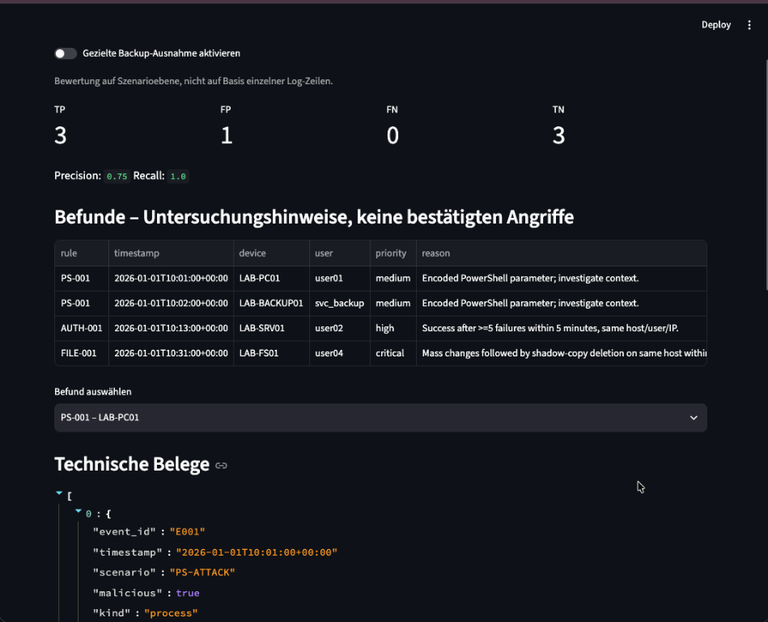
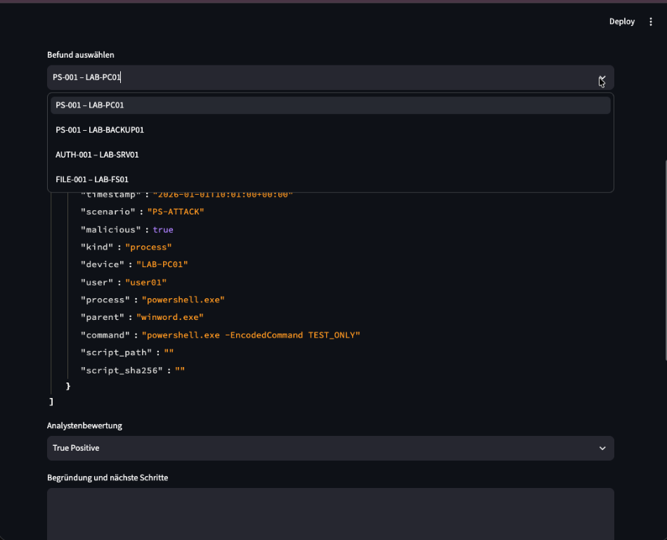
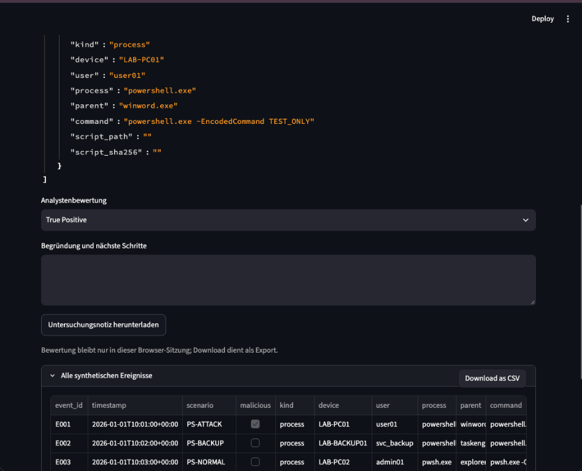
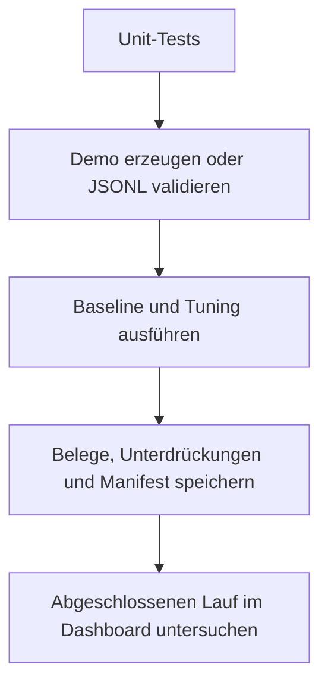

# SOC Portfolio Lab v3 – erkennen, prüfen, nachvollziehbar automatisieren

Lokales Lernprojekt für macOS mit Python 3.11 oder neuer (hier geprüft mit Python 3.12.14 unter Linux). Alle mitgelieferten Ereignisse sind synthetisch. Das Lab führt keine protokollierten Befehle aus und enthält keine Schnittstelle für Endpoint-Isolation, Kontensperren oder andere Reaktionsmaßnahmen.

## Schnellstart auf deinem Mac

ZIP herunterladen und entpacken. Im **Mac-Terminal**:

```bash
cd ~/Downloads/SOC_Portfolio_Lab_v2
python3 --version
python3 -m venv .venv
source .venv/bin/activate
python -m pip install -r requirements.txt
bash scripts/check.sh
bash scripts/dashboard.sh
```

Falls der Browser die ZIP nicht entpackt hat: zuerst im Downloads-Ordner `unzip SOC_Portfolio_Lab_v2.zip` ausführen. Projektpfad gegebenenfalls anpassen.

Browser: **http://localhost:8501**. Stoppen: **Ctrl+C**. Kein `sudo` verwenden. Das Dashboard bleibt an `127.0.0.1` gebunden. CORS- und XSRF-Schutz bleiben eingeschaltet; Nutzungsstatistiken sind deaktiviert. Die Konfiguration ist in `.streamlit/config.toml` festgehalten. Das ist keine Anmeldung oder Mehrbenutzer-Absicherung; den Dienst nicht öffentlich freigeben.

| Befehl | Wo? | Zweck |
|---|---|---|
| `python3 -m venv .venv` | Terminal im Projektordner | Pakete isolieren |
| `python -m pip install -r requirements.txt` | Aktivierte Umgebung | Getestete direkte Streamlit-Version installieren; benötigt Internet |
| `bash scripts/check.sh` | Projektordner | Tests, Datenvalidierung, beide Regelvarianten, Auditliste und Berichte automatisch ausführen |
| `bash scripts/dashboard.sh` | Projektordner | Abgeschlossenen Lauf im lokalen Browser untersuchen |
| `python scripts/test_pipeline.py` | Projektordner | Import, Fehlerbehandlung und parallele Aufrufe prüfen |
| `python scripts/test_dashboard.py` | Projektordner, nach synthetischem Prüflauf | Dashboard und Erhalt der Notizen beim Befundwechsel prüfen |

Die Detection und ihre 27 Unit-Tests benötigen nur die Python-Standardbibliothek. Streamlit wird ausschließlich für das Dashboard und dessen UI-Test benötigt. Der UI-Test erwartet die unveränderten Demo-Daten und eine zum Laufzeitpunkt gültige Backup-Ausnahme.

## Was gegenüber dem ursprünglichen Lab verbessert wurde

| Bereich | Änderung | Nutzen |
|---|---|---|
| Eingaben | Strenges JSON, Zeitzonenpflicht, Schema-/Typprüfung, eindeutige Ereignis-IDs, IP-Prüfung | Fehlerhafte Daten werden abgewiesen |
| Grenzen | Maximal 10 MiB pro Import und 20.000 Ereignisse | Begrenzter Batch; kein ungebremster Log-Import |
| Anmeldung | Gerät + Konto + normalisierte IP + Anmeldetyp; gleitendes Fenster | Unterschiedliche Anmeldekontexte werden getrennt |
| Zeitfolge | Vorgänger müssen zeitlich früher sein | Gleichzeitige Ereignisse belegen keine Reihenfolge |
| Ausnahme | Vier exakte Merkmale, Verantwortlicher, Grund, Ablaufdatum | Eng begrenzte, überprüfbare Unterdrückung |
| Transparenz | `suppressed.json` mit Ereignis- und Ausnahme-ID | Unterdrückte Treffer bleiben nachvollziehbar |
| Ausgaben | Eigener Ordner pro Lauf, atomare Einzeldateien, Abschlusszeiger | Ein fehlgeschlagener Lauf ersetzt den letzten vollständigen Lauf nicht |
| Nachweis | Regelversion, stabile Alarm-IDs, Daten-/Quellcode-Hashes | Ergebnisse lassen sich einem konkreten Stand zuordnen |
| Triage | Notizen und Bewertung pro Befund; Export mit Lauf-ID | Befundwechsel vermischt keine Notizen |
| Automatisierung | Ein Befehl, Prozesssperre, vorbereitete GitHub-Prüfung und Mac-Timer | Wiederholbare Prüfung ohne Endpoint-Eingriffe |

## Screenshots

Alle Daten sind synthetisch. Die Aufnahmen stammen aus einem früheren Stand des Dashboards und zeigen Baseline (Ausnahme aus): 3 TP, 1 FP.

| Befunde und Metriken | Befund auswählen | Belege und Triage |
|---|---|---|
|  |  |  |

## Ablauf



`pipeline.py` beendet sich bei fehlerhaften Daten mit Exit-Code 1, bei einem bereits laufenden Prozess mit Exit-Code 2. Der Prozess-Lock wird vom Betriebssystem beim Prozessende freigegeben. Interne Tests dürfen höchstens 120 Sekunden laufen. Ein Abbruch kann einen unvollständigen Laufordner hinterlassen; das Dashboard verwendet weiterhin den bisherigen Abschlusszeiger.

Ausgaben:

- `reports/latest.json`: ID des letzten vollständigen Laufs.
- `reports/runs/<ID>/events.jsonl`: eingefrorene Eingabedaten.
- `alerts_baseline.json`, `alerts_tuned.json`: Befunde mit Ereignis-IDs.
- `suppressed.json`: genau die durch Tuning unterdrückten Treffer.
- `exception_policy.json`: verwendete Ausnahme.
- `metrics.json`: Bewertung, sofern alle Ereignisse Testlabels haben.
- `manifest.json`: UTC-Zeit, Regelversion und SHA-256-Werte.
- `tests.txt`: Testergebnis dieses Laufs.

Neue Dateien werden privat mit Modus 0600 erzeugt; neue Laufordner mit 0700. Bereits vorhandene Verzeichnisrechte werden dadurch nicht rückwirkend geändert. Dateien in einem Projektordner, den andere Benutzer verändern können, sind keine vertrauenswürdige Grenze. Hashes ohne extern geschützte Signatur sind kein manipulationssicheres Audit. Keine automatische Löschung: alte Laufordner und Scheduler-Logs regelmäßig prüfen und nach eigener Aufbewahrungsentscheidung entfernen.

## Regeln und klare Grenzen

| Regel | Bedingung | Wichtige Einschränkung |
|---|---|---|
| PS-001 | `powershell.exe` oder `pwsh.exe` plus erkannter Encoding-Switch, z. B. `-e`, `-enc`, `-EncodedCommand` | Regex-Heuristik, kein PowerShell-Parser; kann Befehle in Textargumenten treffen und Verschleierungen übersehen |
| AUTH-001 | Mindestens fünf Fehler innerhalb der letzten fünf Minuten vor einem Erfolg; gleicher Host/Konto/IP/Anmeldetyp | Genau fünf Minuten sind enthalten; gleicher Zeitstempel belegt kein „danach“; ein Erfolg verbraucht die Fehlersequenz |
| FILE-001 | Ein aggregiertes Ereignis mit mindestens 500 Dateiänderungen, danach Shadow-Copy-Löschung auf gleichem Host innerhalb von zwei Minuten | Host-Korrelation, kein Beweis einer gemeinsamen Ursache; Konten dürfen verschieden sein |

`file_burst.changed_files` muss eine vorgeschaltete vertrauenswürdige Quelle liefern. Dieses Lab zählt keine Roh-Dateioperationen und prüft keine echte Schattenkopie-Löschung. Es ist Batch-Verarbeitung; Live-Aufnahme, Checkpoints, verspätete Ereignisse über mehrere Batches, zentrale Alarm-Deduplizierung und HA sind nicht implementiert. Wiederholte Batches können dieselben Alarm-IDs ausgeben.

Bei Rohdaten zuerst Geräte-/Kontokennung, Domäne, IP und Zeitquelle normalisieren. Das Lab behandelt Gerätenamen und Benutzernamen exakt; es löst keine Aliase auf. Leere oder unbekannte Felder sollen nicht durch erfundene Standardwerte ersetzt werden.

## Backup-Ausnahme sicher prüfen

`config/backup_exception.json` verlangt gleichzeitig Gerät, Benutzer, Skriptpfad und Skript-SHA-256. Das mitgelieferte Ablaufdatum ist **28. November 2026, 00:00 UTC**. Danach bleibt der Backup-Treffer sichtbar, auch beim erneuten Auswerten alter Logs. Tests verwenden eine feste Bewertungszeit, damit historische Benchmark-Prüfungen nicht mit der Uhr ablaufen.

Vor einer Verlängerung Verantwortlichen, Grund und Belege prüfen; anschließend Tests und Pipeline erneut ausführen. Der derzeitige Owner ist ausdrücklich ein Lab-Platzhalter. Das Lab vertraut den gelieferten Metadaten: Es liest kein echtes Skript und verifiziert keine digitale Signatur. In einer echten Datenquelle darf ein Angreifer die vier Ausnahmefelder nicht selbst frei behaupten können. Eine erfolgreiche Hash-Prüfung allein beweist kein sicheres Laufzeitverhalten.

Auf diesem Datensatz mit sieben Szenarien:

| Zustand | TP | FP | FN | TN | Precision | Recall |
|---|---:|---:|---:|---:|---:|---:|
| Baseline | 3 | 1 | 0 | 3 | 75 % | 100 % |
| Tuning mit gültiger Ausnahme | 3 | 0 | 0 | 4 | 100 % | 100 % |

Keine Produktionskennzahlen. `scenario` und `malicious` werden nur zur Bewertung benutzt, nicht zur Erkennung. Zugewiesene Testlabels müssen unabhängig überprüft werden. Ohne vollständige Labels gibt das Lab keine Accuracy-Metriken aus.

## Eigene normalisierte JSONL-Datei prüfen

Im Projektordner:

```bash
mkdir -p imports
python pipeline.py --input imports/events.jsonl
```

Die Datei vorher selbst bereitstellen. Es gibt keinen automatischen Defender-/Graph-Download. Beispiele für das Lab-Schema findest du im mitgelieferten `data/events.jsonl` und im letzten Lauf. Pflichtfelder jedes Ereignisses: `event_id`, `timestamp` mit Zeitzone, `device`, `user`, `kind`.

| `kind` | Weitere Pflichtfelder |
|---|---|
| `process` | `process`, `command`; optionale Strings: `parent`, `script_path`, `script_sha256` |
| `login` | `src_ip` als gültiger IP-String, `outcome` = `failure` oder `success`, `logon_type` als nichtnegative Ganzzahl |
| `file_burst` | `changed_files` als nichtnegative Ganzzahl bis 1 Milliarde |
| `shadow_delete` | Keine weiteren Pflichtfelder im Lab-Schema |

Leere Zeilen werden ignoriert. Ungültige Zeilen, doppelte JSON-Schlüssel, doppelte Event-IDs, NaN/Infinity und widersprüchliche Szenario-Labels brechen die Verarbeitung ab. Labels optional, wenn vorhanden: `scenario` als nichtleerer String und `malicious` als Boolean.

`data/`, `imports/`, `exports/`, `reports/`, Umgebungsdateien und Streamlit-Secrets werden von Git ignoriert. `.gitignore` entfernt keine schon versionierten Daten! Nur synthetische, geprüfte Beispiele veröffentlichen. Keine API-Secrets oder Kundendaten eintragen.

## Automatisierung auf dem Mac – optional täglich

Zuerst einen erfolgreichen manuellen Lauf durchführen. Generator im **Mac-Terminal** ausführen:

```bash
python scripts/make_launchagent.py
plutil -lint reports/local.launchagent.plist
launchctl bootstrap "gui/$(id -u)" "$PWD/reports/local.launchagent.plist"
```

Der Generator erzeugt nur eine Konfiguration. Erst `launchctl bootstrap` aktiviert sie: synthetischer Prüflauf ungefähr alle 86.400 Sekunden, solange der Benutzeragent geladen ist. Keine Zusage einer festen Uhrzeit oder Ausführung während der Mac ausgeschaltet ist. Projekt und `.venv` müssen unter demselben Pfad bleiben. Erster Lauf nach dem Intervall; sofort testen:

```bash
launchctl kickstart "gui/$(id -u)/de.local.soc-portfolio-lab"
```

Protokolle: `reports/scheduler.out.log`, `reports/scheduler.err.log`. Stoppen/entladen:

```bash
launchctl bootout "gui/$(id -u)" "$PWD/reports/local.launchagent.plist"
```

Diese Variante ist bewusst temporär geladen und wird nicht automatisch für den nächsten Login installiert. Nach erneutem Login bei Bedarf wieder `bootstrap` ausführen. Für dauerhaftes Laden kannst du die geprüfte Plist selbst unter `~/Library/LaunchAgents/de.local.soc-portfolio-lab.plist` ablegen und diesen Pfad für `bootstrap`/`bootout` verwenden. Der Generator startet keinen Timer und wurde hier nicht auf macOS ausgeführt.

## Automatische Prüfung in GitHub – vorbereitet

`.github/workflows/check.yml` prüft nach einem eigenen Upload Pushes und Pull Requests; zusätzlich ist ein manueller Lauf möglich. Es ist noch kein Repository hochgeladen und keine Remote-Prüfung aktiviert worden.

Detection-Job: Standardbibliothek, synthetische Daten, Leseberechtigung. Separater Audit-Job: Paketinstallation und Online-Schwachstellenabfrage. Checkout ist auf einen konkreten Commit gepinnt und speichert keine Git-Zugangsdaten. Keine Deployment-Schritte, keine Secrets, kein `pull_request_target`. Die Workflow-Ausführung selbst wurde hier nicht auf GitHub geprüft. API-/Netzwerkfehler lassen den Audit-Job fehlschlagen und sind kein Beweis für eine Schwachstelle.

## Abhängigkeiten prüfen und aktualisieren

Streamlit ist direkt auf die getestete Version gepinnt. Transitive Abhängigkeiten sind nicht plattformübergreifend vollständig gesperrt; eine spätere Mac-Installation kann andere kompatible Versionen auflösen. Nach Installation **auf deinem Mac**:

```bash
python -m pip install -r requirements-audit.txt
python -m pip_audit -r requirements.txt
python -m pip freeze > reports/installed-packages.txt
```

`pip-audit` sendet Paketnamen/-versionen an einen Schwachstellendienst, keine Lab-Ereignisse. Ergebnis „keine bekannten Schwachstellen“ ist eine Momentaufnahme. Fehler niemals durch pauschales Ignorieren von Advisories beheben. Fix-Version auswählen, Pin aktualisieren und alle Prüfungen wiederholen. Vollständig reproduzierbare Offline-Installationen mit Wheel-Hashes für beide Mac-Architekturen sind ein weiterer Ausbauschritt.

## Defender, KQL und Sigma

`queries/defender_powershell.kql` nutzt einen Switch-Regex statt des bisherigen groben `contains "-enc"`, ergänzt Kontext und exportiert `ReportId`. Für Beleg-Identität gemeinsam **DeviceName + Timestamp + ReportId** verwenden. Das SHA-256-Feld von `DeviceProcessEvents` bezieht sich auf das Prozessabbild, nicht auf das ausgeführte Skript; es darf die Skript-Ausnahme nicht direkt bedienen. Defender for Endpoint muss Telemetrie liefern, und deine Rolle muss die Suche erlauben.

`queries/sentinel_lab.kql` ist eine eigenständige Lernabfrage mit eingebauten Testdaten und vier Negativkontrollen (erwartet: genau 2 Treffer, E001 und E002). `rules/encoded_powershell.yml` nutzt dieselbe Schalter-Regex. Python lädt beide Regeldateien nicht; `tests/test_rule_sync.py` stellt aber sicher, dass Python, KQL und Sigma dieselbe Schalterliste verwenden (`-e`, `-ec`, `-en` … `-EncodedCommand`, auch mit `/` oder in Anführungszeichen). Das sind keine verifizierten 1:1-Konvertierungen; Tenant-/Backend-Tests stehen aus.

Für Projekt 3 zunächst nur lesenden Zugriff und freigegebene Testgeräte verwenden. Vor automatischer Reaktion sind Datenqualität, Verantwortlichkeiten und Auswirkungen separat zu validieren. Für Projekt 4: `RUNBOOK.md` ausfüllen und eine Notiz exportieren. Der JSON-Export enthält `response_executed: false`.

## Prüfstand dieses Pakets

Siehe `VALIDATION.md`. Die ZIP enthält einen vollständigen synthetischen Beispiellauf. Für deinen eigenen Nachweis die Pipeline auf deinem Mac erneut ausführen, Dashboard prüfen und Untersuchung exportieren.

## Primärquellen

- Streamlit-Konfiguration: https://docs.streamlit.io/develop/api-reference/configuration/config.toml
- Streamlit-Installation: https://docs.streamlit.io/get-started/installation/command-line
- Defender-Prozessschema: https://learn.microsoft.com/en-us/defender-xdr/advanced-hunting-deviceprocessevents-table
- Kusto Regex-Operator: https://learn.microsoft.com/en-us/kusto/query/matches-regex-operator
- Kusto Regex-Syntax: https://learn.microsoft.com/en-us/kusto/query/regex
- Gepinnter Checkout-Commit: https://github.com/actions/checkout/commit/3d3c42e5aac5ba805825da76410c181273ba90b1
